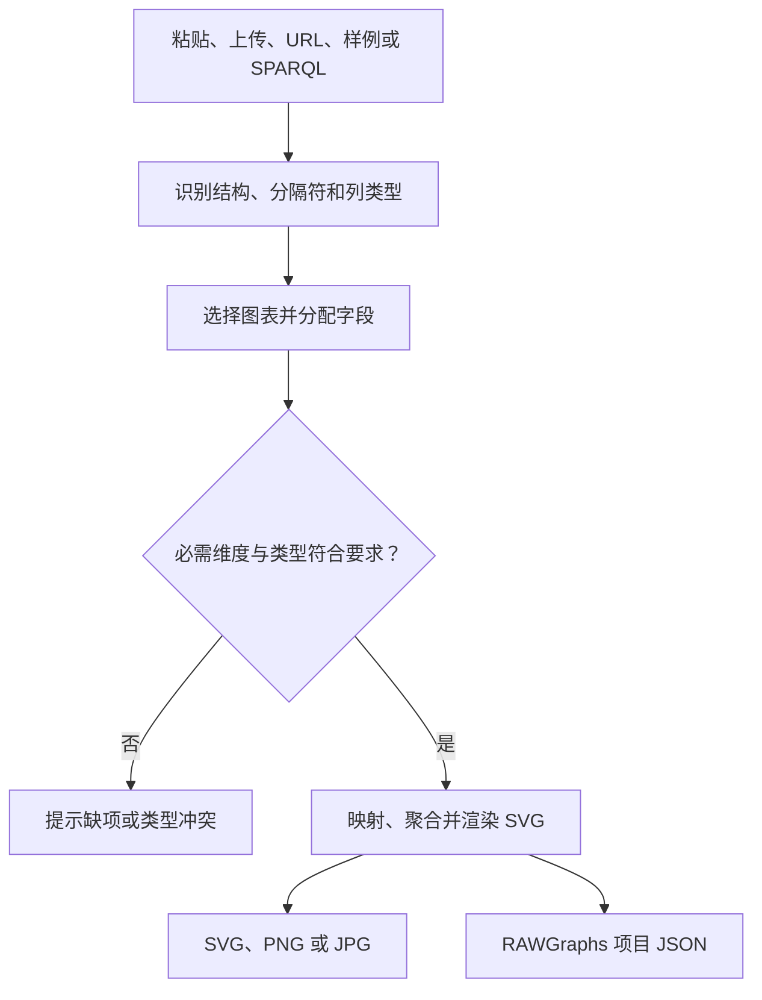

# 01｜源码架构、数据流和复核记录

## 应用、图表定义与执行层

| 层 | 本版本的职责 | 源码依据 |
| --- | --- | --- |
| App | React 管理输入、所选图表、字段映射、视觉参数和导出状态；页面按五步展开 | [App.js](https://github.com/rawgraphs/rawgraphs-app/blob/48c3b2ee9ff412721a2c99c7bed38e734b3fa534/src/App.js) |
| 图表注册与选择 | App 显式注册 Charts 包和 Calendar Heatmap 包的图表。选择器使用图表元数据中的类别、描述、图标与教程链接 | [charts.js](https://github.com/rawgraphs/rawgraphs-app/blob/48c3b2ee9ff412721a2c99c7bed38e734b3fa534/src/charts.js) · [ChartSelector.js](https://github.com/rawgraphs/rawgraphs-app/blob/48c3b2ee9ff412721a2c99c7bed38e734b3fa534/src/components/ChartSelector/ChartSelector.js) |
| Core | 负责类型解析、映射、选项默认值、渲染调用及项目序列化；图表声明具体维度和绘制逻辑 | [Core 仓库](https://github.com/rawgraphs/rawgraphs-core) · [锁文件](https://github.com/rawgraphs/rawgraphs-app/blob/48c3b2ee9ff412721a2c99c7bed38e734b3fa534/package-lock.json) |
| Worker | 通过 Comlink 调用解析或数据映射；前端预览组件在 DOM 中渲染 | [worker/index.js](https://github.com/rawgraphs/rawgraphs-app/blob/48c3b2ee9ff412721a2c99c7bed38e734b3fa534/src/worker/index.js) · [worker.js](https://github.com/rawgraphs/rawgraphs-app/blob/48c3b2ee9ff412721a2c99c7bed38e734b3fa534/src/worker/worker.js) |
| 交付 | 用 Vite 编译静态应用，开发部署和正式部署使用不同触发条件 | [Vite 配置](https://github.com/rawgraphs/rawgraphs-app/blob/48c3b2ee9ff412721a2c99c7bed38e734b3fa534/vite.config.js) · [dev 工作流](https://github.com/rawgraphs/rawgraphs-app/blob/48c3b2ee9ff412721a2c99c7bed38e734b3fa534/.github/workflows/dev.yml) · [prod 工作流](https://github.com/rawgraphs/rawgraphs-app/blob/48c3b2ee9ff412721a2c99c7bed38e734b3fa534/.github/workflows/prod.yml) |

锁文件中的直接依赖包括 `rawgraphs-core 1.0.0`、`rawgraphs-charts 1.1.0`、Calendar Heatmap `1.0.0-beta.8`。App 实际从 Core 导入项目读写函数，因此项目格式以锁定依赖的执行结果为准。仓库中另有 `src/import_export_v1*.js` 文件，阅读时应先确认是否处在当前调用路径。 [包清单](https://github.com/rawgraphs/rawgraphs-app/blob/48c3b2ee9ff412721a2c99c7bed38e734b3fa534/package.json) · [锁文件](https://github.com/rawgraphs/rawgraphs-app/blob/48c3b2ee9ff412721a2c99c7bed38e734b3fa534/package-lock.json) · [App.js](https://github.com/rawgraphs/rawgraphs-app/blob/48c3b2ee9ff412721a2c99c7bed38e734b3fa534/src/App.js)

## 从表格到画面

### 1. 加载与解析

`useDataLoader` 区分原始输入、初步表结构、带列类型的可绘制数据。初筛依序尝试已标记的 SPARQL 结果、JSON、分隔文本。分隔符未知时比较候选解析结果；因此地址、备注或格式不统一的输入应人工核对列数。嵌套 JSON 可先选数组，再把数组和一层嵌套对象转换为表字段。地区设置及小数、千分位影响类型解析。 [解析辅助模块](https://github.com/rawgraphs/rawgraphs-app/blob/48c3b2ee9ff412721a2c99c7bed38e734b3fa534/src/hooks/useDataLoaderUtils/parser.js) · [数据加载 Hook](https://github.com/rawgraphs/rawgraphs-app/blob/48c3b2ee9ff412721a2c99c7bed38e734b3fa534/src/hooks/useDataLoader.js)

`stackData` 把宽表改成长表：保留指定键，其余列名进入 `column`，原来单元格进入 `value`。例如“年份、木雕、砖雕、石雕”变成“年份、工艺、值”三列，每年对应三行。这样可把工艺映射为系列，把值映射为高度。替换数据时会检查新表解析结果、旧列是否缺失、沿用旧列类型后是否仍可解析。 [stack.js](https://github.com/rawgraphs/rawgraphs-app/blob/48c3b2ee9ff412721a2c99c7bed38e734b3fa534/src/hooks/useDataLoaderUtils/stack.js) · [useDataLoader.js](https://github.com/rawgraphs/rawgraphs-app/blob/48c3b2ee9ff412721a2c99c7bed38e734b3fa534/src/hooks/useDataLoader.js)

### 2. 表字段到图表变量

图表定义为每个维度声明 `id`、`required`、`validTypes`，并按需要声明多字段、最少字段数或聚合默认值。拖拽先暂存在组件状态，再提交给预览。选新图会重置映射和样式默认值，列名变化会清除失效映射。Preview 检查必需项、多字段最少数量和类型合法性，失败时清除预览或取消导出状态。 [DataMapping.js](https://github.com/rawgraphs/rawgraphs-app/blob/48c3b2ee9ff412721a2c99c7bed38e734b3fa534/src/components/DataMapping/DataMapping.js) · [ChartDimensionCard.js](https://github.com/rawgraphs/rawgraphs-app/blob/48c3b2ee9ff412721a2c99c7bed38e734b3fa534/src/components/DataMapping/ChartDimensionCard.js) · [ChartPreview.js](https://github.com/rawgraphs/rawgraphs-app/blob/48c3b2ee9ff412721a2c99c7bed38e734b3fa534/src/components/ChartPreview/ChartPreview.js)

### 3. 聚合、样式和预览

Worker 默认开启。解析和映射各有独立的延迟初始化 Worker，映射阶段得到可绘制数据后再交给预览。样式控件依据图表的 `visualOptions` 生成，部分选项还依赖映射后的数据。预览对样式输入作 200 毫秒防抖。复用该结构时，字段角色、聚合规则和标记外观值得写成三个明确的层。 [常量](https://github.com/rawgraphs/rawgraphs-app/blob/48c3b2ee9ff412721a2c99c7bed38e734b3fa534/src/constants.js) · [预览协调组件](https://github.com/rawgraphs/rawgraphs-app/blob/48c3b2ee9ff412721a2c99c7bed38e734b3fa534/src/components/ChartPreviewWIthOptions/ChartPreviewWithOptions.js) · [选项面板](https://github.com/rawgraphs/rawgraphs-app/blob/48c3b2ee9ff412721a2c99c7bed38e734b3fa534/src/components/ChartOptions/ChartOptions.js) · [预览](https://github.com/rawgraphs/rawgraphs-app/blob/48c3b2ee9ff412721a2c99c7bed38e734b3fa534/src/components/ChartPreview/ChartPreview.js)

### 4. 导出和恢复

| 格式 | 实现 | 使用场景 |
| --- | --- | --- |
| SVG | 序列化已渲染的首个图形节点 | 进入 Illustrator 或 Inkscape 复核文字、分组、画板和图例 |
| PNG、JPG | 把 SVG 载入图像并绘制至 Canvas | 浏览、排版预览和固定像素交付 |
| RAWGraphs | 导出 JSON，保存输入、解析信息、列类型、图表、映射和选项；可能带自定义图表信息 | 恢复工程或记录制作口径；分享前核对包含的数据 |

内置图表之外，仓库支持由 URL、npm、本地文件或项目引入自定义图表，并在相应路径要求用户确认。数据处理主要在浏览器侧进行，远程数据源、SPARQL、自定义图表和分析统计代码仍有各自网络行为。 [导出组件](https://github.com/rawgraphs/rawgraphs-app/blob/48c3b2ee9ff412721a2c99c7bed38e734b3fa534/src/components/Exporter/Exporter.js) · [项目读写调用](https://github.com/rawgraphs/rawgraphs-app/blob/48c3b2ee9ff412721a2c99c7bed38e734b3fa534/src/App.js) · [自定义图表确认](https://github.com/rawgraphs/rawgraphs-app/blob/48c3b2ee9ff412721a2c99c7bed38e734b3fa534/src/hooks/useSafeCustomCharts.js) · [事件记录](https://github.com/rawgraphs/rawgraphs-app/blob/48c3b2ee9ff412721a2c99c7bed38e734b3fa534/src/gaEvents.js)

## 实测与复核

| 验证项 | 结果 |
| --- | --- |
| 依赖重装及生产构建 | Node 24.22.3、npm 11.19.1 下 `npm ci` 和 `npm run build` 成功，输出 `build/`；构建报告 Sass 弃用及产物分块体积提示 |
| 字段推断及条形聚合 | 字符串列 `Category`、数值列 `Value`；A 的两行 2、5 聚为 7，B 为 3、C 为 4；缺必需 `bars` 映射时 Core 拒绝 |
| Sankey 及 Treemap | 51 条流向映射记录；进入 Coal 的两条值合计 95.33 TWh。Treemap 样例有 101 条映射记录，权重合计 359，并抽查首条多级路径 |
| 项目格式 | 经 Core 序列化得到版本 1.2，JSON 读回后图表 ID、映射和输入一致；空的宽表状态以 `null` 保留 |
| 检测范围 | App 的包脚本和两个部署工作流中未见单独测试命令；本次补了本地验证。环境限制使 Chromium 未能启动，界面拖拽、实际导出和全图表兼容性没有通过端到端验证 |

这次核对的是版本快照。部署工作流配置的 Node 版本是 22.x，开发分支推送与 `v*` 标签分别触发不同部署。 [App 包脚本](https://github.com/rawgraphs/rawgraphs-app/blob/48c3b2ee9ff412721a2c99c7bed38e734b3fa534/package.json) · [迁移报告](https://github.com/rawgraphs/rawgraphs-app/blob/48c3b2ee9ff412721a2c99c7bed38e734b3fa534/RAWGraphs-modernization-report.md) · [开发部署](https://github.com/rawgraphs/rawgraphs-app/blob/48c3b2ee9ff412721a2c99c7bed38e734b3fa534/.github/workflows/dev.yml) · [生产部署](https://github.com/rawgraphs/rawgraphs-app/blob/48c3b2ee9ff412721a2c99c7bed38e734b3fa534/.github/workflows/prod.yml)
